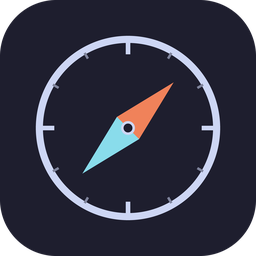
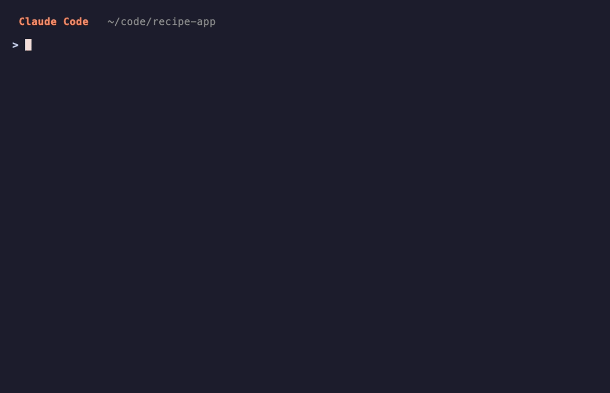

<!-- mph:translation README v0.8.1 -->
<p align="center"></p>

<h1 align="center">multiproject-handoff</h1>

<p align="center"><b>Retoma cualquier proyecto donde lo dejaste, con cualquier agente de programación con IA.</b><br>
Un panel para todos tus proyectos. Notas que crecen con cada proyecto. Un agente que aprende cómo trabajas.</p>

<p align="center">
<a href="https://github.com/hegecalapkulu/multiproject-handoff/actions/workflows/check.yml"></a>


</p>

<p align="center"><a href="README.md">English</a> · <b>Español</b> · <a href="README.zh.md">中文</a> · <a href="README.pt.md">Português</a> · <a href="README.tr.md">Türkçe</a></p>

> Esta es una traducción. La fuente principal es el [README en inglés](README.md); esta página puede quedarse atrás. La documentación detallada (`docs/`) está en inglés. Las correcciones de la traducción son bienvenidas.

<p align="center"><br>
<sub><code>recipe-app</code> es uno de los proyectos de ejemplo inventados en <a href="examples/workspace/"><code>examples/workspace/</code></a>. Prueba lo mismo tú allí.</sub></p>

```
> /mph-resume

🧭 3 proyectos

1. recipe-app      actualizado hace 1 día
   La búsqueda funciona, pasan 41 pruebas; lista de la compra a medias. Ahora: terminar "quitar elemento".
2. landing-page    actualizado hace 6 días
   Esperando el titular del cliente. Ahora: sección principal.
3. cli-tool        actualizado hace 23 días  ⚠ desactualizado
   v0.2 publicada; lo siguiente es soporte para Windows. Ahora: runner de CI para Windows.

¿Cuál? (número o nombre)
```

**En pocas palabras:** tu asistente de IA lo olvida todo cuando cierras el chat. Esta herramienta le deja una nota breve al final de cada sesión y se la hace leer al inicio de la siguiente, en todos tus proyectos, para que nunca tengas que volver a explicar dónde te quedaste. No hace falta registrarse: las notas son archivos de texto normales en tu ordenador.

Por dentro, `multiproject-handoff` es un conjunto de [Agent Skills](https://agentskills.io) escritas en Markdown simple que cierran cada sesión de programación con IA con una entrega (handoff) limpia y empiezan la siguiente desde una nota breve en lugar de desde cero, **en todos tus proyectos**. Sin servidor, sin base de datos, sin cuenta: solo archivos Markdown junto a tu código.

**Funciona mejor con Claude Code y Codex.** Ambos están probados de principio a fin, incluida una entrega en uno y la continuación en el otro. Está construido sobre el formato abierto Agent Skills, así que es muy compatible con otras herramientas que leen Agent Skills o `AGENTS.md` (Gemini CLI, Antigravity, Cursor, Copilot, Windsurf…). Puede haber pequeñas diferencias en cómo una herramienta maneja algún paso; los reportes son bienvenidos.

## Empieza aquí: 3 pasos

1. **Instala** (una vez). Claude Code: `/plugin install multiproject-handoff --marketplace hegecalapkulu/multiproject-handoff`. Cualquier otra herramienta: pega el texto de [Inicio rápido](#inicio-rápido).
2. **Configura cada proyecto** (una vez). Ábrelo y ejecuta `/mph-setup-project`. Lee el proyecto, hace algunas preguntas y conserva las notas que ya tienes.
3. **En cada sesión:** `/mph-resume` al empezar, `/mph-handoff` al terminar.

Eso es todo. ¿Olvidaste el paso 3? Si una sesión termina sin entrega, el siguiente `/mph-resume` detecta el trabajo sin guardar y ofrece ponerse al día desde git. ¿Olvidaste el paso 2? Cualquier comando `mph-` lo detecta y ofrece configurar el proyecto primero. Todo lo demás se ejecuta solo durante una entrega o cuando lo pides; `/mph-menu` lo muestra todo.

## ¿Qué más puede hacer?

| Quieres… | Usa | Obtienes |
|---|---|---|
| Traer proyectos que ya tienes, con sus notas | `mph-setup-project` | tus archivos se adoptan donde están: nada se mueve ni se renombra |
| Seguir donde lo dejaste sin volver a explicar | `mph-resume` · `mph-handoff` | un estado de 8 líneas como máximo y el siguiente paso |
| Llevar varios proyectos a la vez | el panel de `mph-resume` | todos los proyectos en una pantalla, los olvidados marcados con ⚠ |
| Guardar decisiones e investigación en vez de perderlas en el chat | `mph-decision-log` · `mph-knowledge` | notas que crecen en carpetas a medida que crece el proyecto ([más](docs/knowledge.md)) |
| Que el agente trabaje a tu manera, proyecto por proyecto | `mph-profile` | notas breves y basadas en hechos sobre tu forma de trabajar, locales por defecto ([más](docs/profile.md)) |
| Que el sistema se amplíe solo | `mph-suggest-skill` · `mph-suggest-agent` | skills del proyecto y agentes de ayuda, sugeridos una vez, con tu respuesta recordada ([más](docs/suggestions.md)) |
| Verlo todo como un grafo | `mph-obsidian-map` | notas enlazadas, notas de mapa y un Canvas en Obsidian ([más](docs/obsidian.md)) |

¿Olvidaste un comando? **`mph-menu`** los muestra todos.

## ¿No programas?

Funciona igual para una tesis, un proyecto de investigación, un libro, trabajo para clientes o cualquier otra cosa que hagas con un asistente de IA a lo largo de muchas sesiones. Decisiones, fuentes, entrevistas y "dónde me quedé" son justo lo que guarda. No necesitas git ni pruebas: las notas se escriben igualmente, y la entrega ofrece historial de versiones una sola vez, en una línea, que puedes rechazar para siempre. Mira el [ejemplo `thesis`](examples/workspace/thesis/).

## Inicio rápido

**Claude Code: una línea.** Escribe esto dentro de Claude Code:

```
/plugin install multiproject-handoff --marketplace hegecalapkulu/multiproject-handoff
```

Luego abre una sesión nueva. (Claude Code antiguo: `/plugin marketplace add hegecalapkulu/multiproject-handoff` y después `/plugin install multiproject-handoff@multiproject-handoff`.)

**Cualquier herramienta de IA: que se instale sola.** Pega esto en Codex, Cursor, Gemini CLI, Antigravity, Claude Code o cualquier agente que pueda ejecutar comandos:

```text
Instala multiproject-handoff (https://github.com/hegecalapkulu/multiproject-handoff) para la herramienta de IA en la que estás: clona el repositorio, ejecuta `./install.sh --dry-run` y muéstrame qué cambiaría, y luego instálalo para esta herramienta cuando yo diga que sí. Al final, dime cómo empezar.
```

**O a mano (Codex, Gemini CLI, Antigravity, Cursor… o Claude Code sin plugins):**

```bash
git clone https://github.com/hegecalapkulu/multiproject-handoff.git
cd multiproject-handoff
./install.sh        # encuentra las herramientas de IA de este equipo e instala para cada una
```

**Pruébalo en un minuto:** abre tu herramienta de IA en [`examples/workspace/`](examples/workspace/) (cuatro proyectos de ejemplo, uno de ellos una tesis) y ejecuta `/mph-resume`.

**Úsalo en tu proyecto:** abre el proyecto (o toda una carpeta o bóveda de Obsidian con proyectos) y ejecuta `/mph-setup-project`. Primero mira alrededor: las notas que ya tienes (`TODO.md`, `docs/adr/`, una nota de estado, carpetas de investigación…) se **adoptan donde están**, y solo pregunta lo que no puede deducir, en una sola pantalla. A partir de ahí: `/mph-resume` para empezar una sesión, `/mph-handoff` para terminarla. En herramientas sin comandos de barra, basta con decir "resume" o "handoff".

## Cómo funciona

Abres tu agente y escribes `mph-resume`. Busca los proyectos, lee solo las primeras líneas de la nota de continuación de cada uno y muestra el panel. Eliges uno. Entonces lee la nota de continuación de ese proyecto, lo primero de su backlog y tus notas de estilo de trabajo, y te dice en pocas líneas cómo están las cosas y qué sigue. Ese proyecto queda activo toda la sesión; ninguna skill vuelve a preguntar.

**¿Usas más de una herramienta de IA?** Las notas son archivos simples, así que Claude Code, Codex, Cursor y las demás leen las mismas: entrega en una y continúa en otra. Úsalas **de una en una** en cada proyecto; no saben unas de otras, así que dos agentes escribiendo la misma nota a la vez pueden sobrescribirse.

Trabajas. Cuando eliges algo ("usemos SQLite, no un servicio de búsqueda"), `mph-decision-log` lo anota con el motivo. Cuando investigas a la competencia o hablas con un cliente, `mph-knowledge` lo archiva bajo un tema. Menciona un arreglo que pertenece a otro proyecto y acaba en el backlog de *ese* proyecto.

Cuando paras, escribes `mph-handoff`. Comprueba lo que de verdad pasó a partir de git y las pruebas, no de memoria, y muestra una línea: *hará: registro · decisión · conocimiento · nota de continuación · commit; omitirá: perfil (nada nuevo)*. Pulsas Enter. Escribe solo lo que produjo esta sesión, reescribe la nota de continuación de forma breve y hace commit. ¿Tienes prisa? `mph-handoff quick` guarda solo la nota de continuación. ¿Aún no hay git en la carpeta? La entrega ofrece iniciarlo, una vez, con una línea explicando por qué: cada entrega se convierte en una versión a la que puedes volver. Di "ahora no" y volverá a preguntar la próxima vez; di "nunca" y dejará de preguntar.

Con las semanas, las notas crecen: un archivo de competencia se convierte en una carpeta, las decisiones se dividen por área y, si sigues haciendo la misma tarea a mano, la entrega pregunta una vez si quieres una skill para ello, y recuerda tu respuesta. [Recorrido completo →](docs/how-it-works.md)

## Qué hay en un proyecto

```
recipe-app/notes/
├── PROJECT.md          tus ajustes: comprobaciones, módulos, mapas, reglas de estructura
├── RESUME.md           ≤60 líneas: dónde estamos · probado, no funcionó · preguntas abiertas · siguiente
├── BACKLOG.md          solo trabajo pendiente
├── decisions/          cada decisión + fecha + por qué
├── knowledge/          investigación, competencia, entrevistas… crece en carpetas
├── daily/              registro al que solo se añade
└── working-style.md    cómo te gusta trabajar aquí (ignorado por git por defecto)
```

**¿Repositorio público, o prefieres que tus notas sean privadas?** Las notas no tienen que estar junto al código: guárdalas en una carpeta privada o en una bóveda de Obsidian y apunta al código desde `PROJECT.md` ([cómo](docs/how-it-works.md#where-the-files-live)). ¿Trabajas en equipo? Mira [Uso en equipo](docs/team.md).

**Los proyectos se reconocen por una marca, no por nombres de archivo.** La primera línea de `PROJECT.md` (`<!-- mph:project recipe-app -->`) marca la carpeta de notas, así que un `RESUME.md` que en realidad es tu currículum, o una carpeta `notes/` llena de actas de reuniones, nunca se confunden con las nuestras. La carpeta de notas puede llamarse como quieras (`notes/`, `.mph/`, `00 Notas/`). Mira [`examples/workspace/landing-page/`](examples/workspace/landing-page/): un proyecto adoptado cuya propia carpeta `notes/` se deja intacta.

**Tu estructura, tus reglas.** Todo lo relativo a cómo se organizan las notas vive en `PROJECT.md`: nombres de carpetas, idioma, numeración, dónde va cada cosa, qué módulos están activos. Todas las skills lo siguen, así que un proyecto de cliente, una tesis y una app personal pueden verse cada uno como quieras con las mismas skills. [Más →](docs/knowledge.md#your-structure-your-rules)

## Skills

**Núcleo** (siempre activas)

| Skill | Qué hace |
|---|---|
| `mph-resume [proyecto]` | Panel de todos los proyectos, o directo a uno. Solo lectura. |
| `mph-handoff [quick]` | Hechos de git y pruebas → plan de una línea → escribe solo lo que produjo la sesión → commit. |
| `mph-setup-project` | Configura un proyecto o adopta las notas que ya tiene (él o toda una bóveda). Nunca mueve, renombra ni sobrescribe. |
| `mph-decision-log` | Una decisión con su motivo; sustituye a la anterior cuando cambia. |
| `mph-daily-log` | El registro de hoy sin una entrega completa. |
| `mph-menu` | Todos los comandos en una pantalla, más el proyecto activo. |

**Módulos** (se activan o desactivan por proyecto en `PROJECT.md`)

| Skill | Módulo | Por defecto | Qué hace |
|---|---|---|---|
| `mph-knowledge` | knowledge | activo | Archiva la investigación por temas; propone temas nuevos y divisiones; "organiza las notas". |
| `mph-profile` | profile | activo | Estilo de trabajo por proyecto; pasa a un perfil general cuando se ve en dos proyectos. |
| `mph-suggest-skill` | suggestions | activo | Detecta trabajo manual repetido, sugiere una skill del proyecto y recuerda la respuesta. |
| `mph-suggest-agent` | suggestions | activo | Sugiere un agente de ayuda para trabajo pesado y ruidoso. |
| `mph-obsidian-map` | obsidian | inactivo | Enlaza notas, añade etiquetas, mantiene notas de mapa y un Canvas. |

**Protección opcional:** `mph-guard` instala un hook de Claude Code que bloquea *de verdad* borrar archivos, reescribir el historial de git y leer secretos de `.env`, y pregunta antes de los comandos que indiques (deploy, publish). Tú eliges qué bloquea; solo cambia tus ajustes después de un sí. [Más →](docs/install.md#safety-guard)

Todas las skills leen primero un [`RULES.md`](shared/RULES.md) compartido: cómo se encuentran los proyectos, el proyecto activo, los módulos y las reglas de seguridad.

## Instalación según tu herramienta

`./install.sh` detecta Claude Code, Codex, Gemini CLI y Antigravity. Para elegir:

<details>
<summary>Opciones</summary>

| Usas | Comando |
|---|---|
| Claude Code | `./install.sh --tool claude` → `~/.claude/skills/` |
| Codex | `./install.sh --tool codex` → `~/.codex/skills/` |
| Herramientas que leen `~/.agents/skills` | `./install.sh --tool agents` |
| Gemini CLI | `./install.sh --tool gemini` → `~/.gemini/skills/` |
| Antigravity | `./install.sh --tool antigravity` → `~/.gemini/antigravity/skills/` |
| Cualquier carpeta de skills | `./install.sh --dir RUTA` |
| Solo un proyecto | `./install.sh --project ~/code/app [--tool claude]` |
| Sin soporte de skills (Cursor, Copilot, Windsurf…) | `./install.sh --agents-md ~/code` añade un bloque breve a `AGENTS.md` |

En Windows, ejecútalo desde Git Bash (viene con Git for Windows) o WSL; ver [Windows](docs/install.md#windows). Añade `--dry-run` para ver qué pasaría y `--update` para actualizar. Las carpetas de skills cambian entre herramientas y versiones; si tu herramienta no ve las skills, consulta su documentación y usa `--dir`. [Detalles →](docs/install.md)

</details>

El instalador nunca borra nada, omite las skills con el mismo nombre que no son nuestras y añade a `AGENTS.md` una sola vez.

## Desinstalar

No se borra nada: lo instalado se **mueve** a `~/.handoff-removed/<fecha-hora>/` y **tus notas de proyecto se quedan** como Markdown simple.

1. **Plugin de Claude Code:** escribe `/plugin uninstall multiproject-handoff` (y `/plugin marketplace remove multiproject-handoff`).
2. **Instalado con `install.sh`, o si configuraste la protección:** desde la carpeta del repositorio, mira primero y luego quita:
   ```bash
   ./install.sh --uninstall --dry-run
   ./install.sh --uninstall
   ```
   Solo mueve las skills que marcó nuestro instalador, nuestros archivos en `~/.handoff/`, las entradas de la protección en `~/.claude/settings.json` (se guarda una copia) y, con `--agents-md DIR`, el bloque de `DIR/AGENTS.md`. Tus propias skills, hooks y notas de estilo de trabajo se quedan.
3. **O deja que lo haga tu herramienta de IA.** Pega:
   ```text
   Desinstala multiproject-handoff (https://github.com/hegecalapkulu/multiproject-handoff) de este equipo: obtén el repositorio, ejecuta `./install.sh --uninstall --dry-run` y muéstrame qué cambiaría, y luego ejecuta `./install.sh --uninstall --yes` cuando yo diga que sí. Conserva mis notas de proyecto.
   ```

Reinicia tus herramientas después. Cuando estés seguro, borra tú mismo `~/.handoff-removed/`. [Detalles →](docs/install.md#uninstall)

## Seguridad

- **Nunca borra archivos.** Las notas se editan, se amplían o se mueven con `git mv`.
- **Nunca reescribe el historial de git.** Un push fallido se informa, no se fuerza.
- **Nunca afirma trabajo que no ocurrió.** "Las pruebas pasan" solo si pasaron durante la entrega.
- **Tú decides.** Temas nuevos, divisiones, skills y agentes son propuestas hasta que digas que sí.
- **Sin secretos en las notas**, y tu perfil de estilo de trabajo se queda en tu ordenador salvo que elijas otra cosa.
- **¿Lo quieres obligatorio, no solo prometido?** `mph-guard` convierte estas reglas en un hook que bloquea la acción antes de que se ejecute.
- **Sin red, sin cuenta, sin telemetría.** Exactamente qué lee, escribe y cambia en tu equipo: [Resumen de seguridad](docs/security.md).

## ¿Es para ti?

**Sí**, si trabajas en varios proyectos con agentes de IA, cambias de herramienta o pierdes decisiones e investigación entre sesiones. Incluye trabajo que no es código: una tesis, investigación, escritura, proyectos para clientes.

**Probablemente no**, si tienes un solo proyecto pequeño y sesiones cortas (la memoria integrada de tu herramienta basta), si quieres una memoria totalmente automática e invisible (esta te lo muestra todo y pregunta antes de cambiar la estructura), o si tu equipo ya tiene un sistema de documentación con el que está contento.

## En qué se diferencia

La mayoría de las herramientas de este ámbito mantienen **un archivo de entrega para un proyecto**, o un banco de memoria ligado a una herramienta. Esta está hecha para **muchos proyectos a la vez**, da a cada tipo de información su propio ciclo de vida (el estado se reescribe, las decisiones se sustituyen, los registros solo crecen, el conocimiento crece en carpetas) y funciona igual en cualquier agente que lea Markdown. [Comparación y preguntas frecuentes →](docs/comparison.md)

## Documentación (en inglés)

[Cómo funciona](docs/how-it-works.md) · [Seguridad](docs/security.md) · [Equipos](docs/team.md) · [Notas que crecen](docs/knowledge.md) · [Perfil de estilo de trabajo](docs/profile.md) · [Sugerencias](docs/suggestions.md) · [Obsidian](docs/obsidian.md) · [Instalación](docs/install.md) · [Comparación y FAQ](docs/comparison.md) · [Registro de cambios](CHANGELOG.md)

## Contribuir

Issues y PRs son bienvenidos, sobre todo rutas confirmadas de carpetas de skills para más herramientas, ejemplos de `PROJECT.md` para distintos stacks y cambios que hagan que `mph-resume` lea *menos*. También se agradecen las correcciones de la traducción. Después de editar `shared/`, ejecuta `scripts/sync.sh`; antes de un PR, ejecuta `scripts/check.sh`.

## Licencia

MIT
