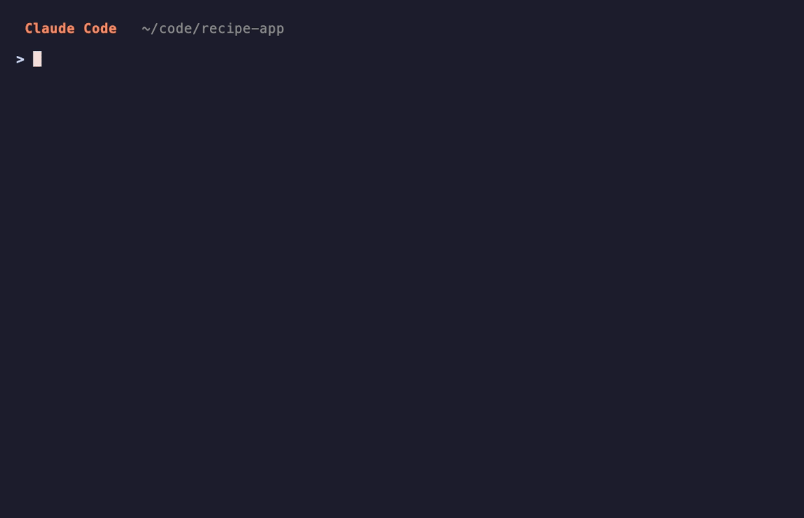

<h1 align="center">🧭 multiproject-handoff</h1>

<p align="center"><b>Pick up any project where you left off, with any AI coding agent.</b><br>
One dashboard for all your projects. Notes that grow with each project. An agent that learns how you work.</p>

<p align="center">
<a href="https://github.com/hegecalapkulu/multiproject-handoff/actions/workflows/check.yml"></a>


</p>

<p align="center"></p>

```
> /mph-resume

🧭 3 projects

1. recipe-app      updated 1 day ago
   Search works, 41 tests pass; shopping list half done. Now: finish "remove item".
2. landing-page    updated 6 days ago
   Waiting on headline copy from the client. Now: hero section.
3. cli-tool        updated 23 days ago  ⚠ stale
   v0.2 released; next is Windows support. Now: Windows CI runner.

Which one? (number or name)
```

`multiproject-handoff` is a set of plain-Markdown [Agent Skills](https://agentskills.io) that end every AI coding session with a clean handoff and start the next one from a short note instead of from scratch, **across all your projects**. No server, no database, no account: just Markdown files next to your code.

**Works best with Claude Code and Codex.** Both are tested end to end, including a handoff in one and a resume in the other. It is built on the open Agent Skills format, so it is highly compatible with other tools that read Agent Skills or `AGENTS.md` (Gemini CLI, Antigravity, Cursor, Copilot, Windsurf…). Minor differences in how a tool handles a step may occasionally come up; reports are welcome.

## What do you need?

| You want to… | Use | You get |
|---|---|---|
| Bring in projects you already have, notes and all | `mph-setup-project` | your existing files adopted where they are: nothing moves or gets renamed |
| Continue where you stopped, without re-explaining | `mph-resume` · `mph-handoff` | a ≤8-line status and the next step |
| Juggle several projects | the `mph-resume` dashboard | every project on one screen, forgotten ones flagged ⚠ |
| Keep decisions and research instead of losing them in chat | `mph-decision-log` · `mph-knowledge` | notes that grow into folders as the project grows ([more](docs/knowledge.md)) |
| Have the agent work your way, project by project | `mph-profile` | short, evidence-based working-style notes, local by default ([more](docs/profile.md)) |
| Let the system extend itself | `mph-suggest-skill` · `mph-suggest-agent` | project skills and helper agents, suggested once, answers remembered ([more](docs/suggestions.md)) |
| See it all as a graph | `mph-obsidian-map` | linked notes, map notes and a Canvas in Obsidian ([more](docs/obsidian.md)) |

Forgot a command? **`mph-menu`** shows them all.

## Quick start

**Claude Code: one line.** Type this inside Claude Code:

```
/plugin install multiproject-handoff --marketplace hegecalapkulu/multiproject-handoff
```

Then start a new session. (Older Claude Code: `/plugin marketplace add hegecalapkulu/multiproject-handoff`, then `/plugin install multiproject-handoff@multiproject-handoff`.)

**Any AI tool: let it install itself.** Paste this into Codex, Cursor, Gemini CLI, Antigravity, Claude Code or any agent that can run commands:

```text
Install multiproject-handoff (https://github.com/hegecalapkulu/multiproject-handoff) for the AI tool you are running in: clone the repo, run `./install.sh --dry-run` and show me what it would change, then install it for this tool after I say yes. Finally, tell me how to start.
```

**Or by hand (Codex, Gemini CLI, Antigravity, Cursor…, or Claude Code without plugins):**

```bash
git clone https://github.com/hegecalapkulu/multiproject-handoff.git
cd multiproject-handoff
./install.sh        # finds the AI tools on this machine and installs for each
```

**Try it in one minute:** open your AI tool in [`examples/workspace/`](examples/workspace/) (three filled-in projects) and run `/mph-resume`.

**Use it on your project:** open the project (or a whole folder or Obsidian vault of projects) and run `/mph-setup-project`. It looks around first: notes you already keep (`TODO.md`, `docs/adr/`, a status note, research folders…) are **adopted where they are**, and it asks only what it can't work out, on one screen. From then on: `/mph-resume` to start a session, `/mph-handoff` to end one. In tools without slash commands, just say "resume" or "handoff".

## How it works

You open your agent and type `mph-resume`. It looks for projects, reads only the first lines of each project's resume note, and shows the dashboard. You pick one. Now it reads that project's short resume note, the top of its backlog and your working-style notes, and tells you in a few lines where things stand and what's next. That project stays active for the whole session; no skill asks again.

**Using more than one AI tool?** The notes are plain files, so Claude Code, Codex, Cursor and the others all read the same ones: hand off in one, resume in another. Use them **one at a time** on a project; they don't know about each other, so two agents writing the same note at once can overwrite each other.

You work. When you choose something ("let's use SQLite, not a search service"), `mph-decision-log` writes it down with the reason. When you research competitors or talk to a customer, `mph-knowledge` files it under a topic. Mention a fix that belongs to another project, and it lands in *that* project's backlog.

When you stop, you type `mph-handoff`. It checks what really happened from git and the tests, not from memory, and shows one line: *will do: log · decision · knowledge · resume note · commit; skip: profile (nothing new)*. You press Enter. It writes only what this session produced, rewrites the resume note short, and commits. Leaving in a hurry? `mph-handoff quick` saves just the resume note.

Over weeks, the notes grow: a competitors file becomes a folder, decisions split by area, and if you keep doing the same chore by hand, the handoff asks once whether you want a skill for it, and remembers your answer. [Full walkthrough →](docs/how-it-works.md)

## What's in a project

```
recipe-app/notes/
├── PROJECT.md          your settings: checks, modules, maps, structure rules
├── RESUME.md           ≤60 lines: where we are · tried, didn't work · open questions · next
├── BACKLOG.md          open work only
├── decisions/          every decision + date + why
├── knowledge/          research, competitors, interviews… grows into folders
├── daily/              append-only log
└── working-style.md    how you like to work here (git-ignored by default)
```

**Projects are recognized by a marker, not by file names.** The first line of `PROJECT.md` (`<!-- mph:project recipe-app -->`) marks the notes folder, so a `RESUME.md` that is really your CV, or a `notes/` folder full of meeting notes, is never mistaken for ours. The notes folder can have any name (`notes/`, `.mph/`, `00 Notes/`). See [`examples/workspace/landing-page/`](examples/workspace/landing-page/): an adopted project whose own `notes/` folder is left alone.

**Your structure, your rules.** Everything about how notes are organized lives in `PROJECT.md`: folder names, language, numbering, where things go, which modules are on. Every skill follows it, so a client project, a thesis and a side app can each look the way you want with the same skills. [More →](docs/knowledge.md#your-structure-your-rules)

## Skills

**Core** (always on)

| Skill | Does |
|---|---|
| `mph-resume [project]` | Dashboard of all projects, or straight into one. Read-only. |
| `mph-handoff [quick]` | Facts from git and tests → one-line plan → writes only what the session produced → commit. |
| `mph-setup-project` | Sets up a project, or adopts the notes it (or a whole vault) already has. Never moves, renames or overwrites. |
| `mph-decision-log` | A decision with its reason; replaces the old one when it changes. |
| `mph-daily-log` | Today's log without a full handoff. |
| `mph-menu` | Every command on one screen, plus the active project. |

**Modules** (switch on or off per project in `PROJECT.md`)

| Skill | Module | Default | Does |
|---|---|---|---|
| `mph-knowledge` | knowledge | on | Files research into topics; proposes new topics and splits; "organize notes". |
| `mph-profile` | profile | on | Working style per project, promoted to a general profile when seen in two projects. |
| `mph-suggest-skill` | suggestions | on | Spots repeated manual work, suggests a project skill, remembers the answer. |
| `mph-suggest-agent` | suggestions | on | Suggests a helper agent for heavy, noisy work. |
| `mph-obsidian-map` | obsidian | off | Links notes, adds tags, keeps map notes and a Canvas. |

**Optional safety guard:** `mph-guard` sets up a Claude Code hook that *really* blocks deleting files, rewriting git history and reading `.env` secrets, and asks before commands you name (deploy, publish). You pick what it blocks; it changes your settings only after a yes. [More →](docs/install.md#safety-guard)

All skills read one shared [`RULES.md`](shared/RULES.md) first: how projects are found, the active project, modules, and the safety rules.

## Install for your tool

`./install.sh` detects Claude Code, Codex, Gemini CLI and Antigravity. To choose:

<details>
<summary>Options</summary>

| You use | Command |
|---|---|
| Claude Code | `./install.sh --tool claude` → `~/.claude/skills/` |
| Codex | `./install.sh --tool codex` → `~/.codex/skills/` |
| Tools reading `~/.agents/skills` | `./install.sh --tool agents` |
| Gemini CLI | `./install.sh --tool gemini` → `~/.gemini/skills/` |
| Antigravity | `./install.sh --tool antigravity` → `~/.gemini/antigravity/skills/` |
| Any skills folder | `./install.sh --dir PATH` |
| One project only | `./install.sh --project ~/code/app [--tool claude]` |
| No skill support (Cursor, Copilot, Windsurf…) | `./install.sh --agents-md ~/code` adds a short block to `AGENTS.md` |

On Windows, run it from Git Bash (comes with Git for Windows) or WSL; see [Windows](docs/install.md#windows). Add `--dry-run` to see what would happen, `--update` to refresh. Skill folders differ between tools and versions; if your tool doesn't see the skills, check its docs and use `--dir`. [Details →](docs/install.md)

</details>

The installer never deletes anything, skips skills with the same name that aren't ours, and appends to `AGENTS.md` only once.

## Safety

- **Never deletes files.** Notes are edited, appended or moved with `git mv`.
- **Never rewrites git history.** A failed push is reported, not forced.
- **Never claims work that didn't happen.** "Tests pass" only if they passed during the handoff.
- **You decide.** New topics, splits, skills and agents are proposals until you say yes.
- **No secrets in notes**, and your working-style profile stays on your computer unless you choose otherwise.
- **Want it enforced, not just promised?** `mph-guard` turns these rules into a hook that blocks the action before it runs.

## Is it for you?

**Yes**, if you work on several projects with AI agents, switch between tools, or keep losing decisions and research between sessions.

**Probably not**, if you have one small project and short sessions (your tool's built-in memory is enough), if you want memory that is fully automatic and invisible (this one shows you everything and asks before changing structure), or if your team already has a documentation system it is happy with.

## How it differs

Most tools in this space keep **one handoff file for one project**, or a memory bank tied to one tool. This one is built for **many projects at once**, gives each kind of information its own lifecycle (state is rewritten, decisions are replaced, logs are append-only, knowledge grows into folders), and works the same in any agent that reads Markdown. [Comparison and FAQ →](docs/comparison.md)

## Documentation

[How it works](docs/how-it-works.md) · [Notes that grow](docs/knowledge.md) · [Working-style profile](docs/profile.md) · [Suggestions](docs/suggestions.md) · [Obsidian](docs/obsidian.md) · [Install](docs/install.md) · [Comparison & FAQ](docs/comparison.md) · [Changelog](CHANGELOG.md)

## Contributing

Issues and PRs welcome, especially confirmed skill-folder paths for more tools, `PROJECT.md` examples for different stacks, and changes that make `mph-resume` read *less*. After editing `shared/`, run `scripts/sync.sh`; before a PR, run `scripts/check.sh`.

## License

MIT
