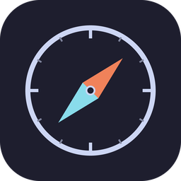
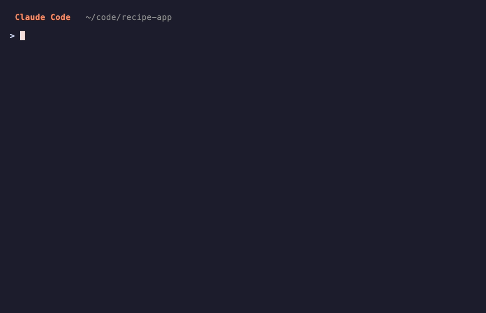

<!-- mph:translation README v0.8.1 -->
<p align="center"></p>

<h1 align="center">multiproject-handoff</h1>

<p align="center"><b>Retome qualquer projeto de onde parou, com qualquer agente de programação com IA.</b><br>
Um painel para todos os seus projetos. Notas que crescem com cada projeto. Um agente que aprende como você trabalha.</p>

<p align="center">
<a href="https://github.com/hegecalapkulu/multiproject-handoff/actions/workflows/check.yml"></a>


</p>

<p align="center"><a href="README.md">English</a> · <a href="README.es.md">Español</a> · <a href="README.zh.md">中文</a> · <b>Português</b> · <a href="README.tr.md">Türkçe</a></p>

> Esta é uma tradução. A fonte principal é o [README em inglês](README.md); esta página pode ficar desatualizada. A documentação detalhada (`docs/`) está em inglês. Correções na tradução são bem-vindas.

<p align="center"><br>
<sub><code>recipe-app</code> é um dos projetos de exemplo fictícios em <a href="examples/workspace/"><code>examples/workspace/</code></a>. Experimente você mesmo lá.</sub></p>

```
> /mph-resume

🧭 3 projetos

1. recipe-app      atualizado há 1 dia
   A busca funciona, 41 testes passam; lista de compras pela metade. Agora: terminar "remover item".
2. landing-page    atualizado há 6 dias
   Aguardando o título do cliente. Agora: seção principal.
3. cli-tool        atualizado há 23 dias  ⚠ desatualizado
   v0.2 lançada; o próximo passo é suporte a Windows. Agora: runner de CI para Windows.

Qual? (número ou nome)
```

**Em poucas palavras:** seu assistente de IA esquece tudo quando você fecha o chat. Esta ferramenta deixa uma nota curta no fim de cada sessão e faz o assistente lê-la no início da próxima, em todos os seus projetos, para que você nunca mais precise explicar onde parou. Não precisa criar conta: as notas são arquivos de texto comuns no seu computador.

Por dentro, o `multiproject-handoff` é um conjunto de [Agent Skills](https://agentskills.io) em Markdown simples que encerra cada sessão de programação com IA com um handoff limpo e começa a próxima a partir de uma nota curta, e não do zero, **em todos os seus projetos**. Sem servidor, sem banco de dados, sem conta: apenas arquivos Markdown ao lado do seu código.

**Funciona melhor com Claude Code e Codex.** Os dois foram testados de ponta a ponta, incluindo um handoff em um e a retomada no outro. É construído sobre o formato aberto Agent Skills, então é altamente compatível com outras ferramentas que leem Agent Skills ou `AGENTS.md` (Gemini CLI, Antigravity, Cursor, Copilot, Windsurf…). Pequenas diferenças na forma como uma ferramenta lida com algum passo podem aparecer de vez em quando; relatos são bem-vindos.

## Comece aqui: 3 passos

1. **Instale** (uma vez). Claude Code: `/plugin install multiproject-handoff --marketplace hegecalapkulu/multiproject-handoff`. Qualquer outra ferramenta: cole o texto de [Início rápido](#início-rápido).
2. **Configure cada projeto** (uma vez). Abra-o e rode `/mph-setup-project`. Ele lê o projeto, faz algumas perguntas e mantém as notas que você já tem.
3. **Em toda sessão:** `/mph-resume` no início, `/mph-handoff` no fim.

É só isso. Esqueceu o passo 3? Se uma sessão terminar sem handoff, o próximo `/mph-resume` percebe o trabalho não salvo e oferece atualizar a nota a partir do git. Esqueceu o passo 2? Qualquer comando `mph-` percebe e oferece configurar o projeto primeiro. Todo o resto roda sozinho durante um handoff ou quando você pede; `/mph-menu` lista tudo.

## O que mais ele faz?

| Você quer… | Use | Você recebe |
|---|---|---|
| Trazer projetos que já tem, com as notas | `mph-setup-project` | seus arquivos são adotados onde estão: nada é movido ou renomeado |
| Continuar de onde parou, sem explicar de novo | `mph-resume` · `mph-handoff` | um status de no máximo 8 linhas e o próximo passo |
| Tocar vários projetos ao mesmo tempo | o painel do `mph-resume` | todos os projetos em uma tela, os esquecidos marcados com ⚠ |
| Guardar decisões e pesquisas em vez de perdê-las no chat | `mph-decision-log` · `mph-knowledge` | notas que viram pastas à medida que o projeto cresce ([mais](docs/knowledge.md)) |
| Que o agente trabalhe do seu jeito, projeto a projeto | `mph-profile` | notas curtas e baseadas em evidências sobre seu jeito de trabalhar, locais por padrão ([mais](docs/profile.md)) |
| Que o sistema se expanda sozinho | `mph-suggest-skill` · `mph-suggest-agent` | skills do projeto e agentes auxiliares, sugeridos uma vez, com a resposta lembrada ([mais](docs/suggestions.md)) |
| Ver tudo como um grafo | `mph-obsidian-map` | notas ligadas, notas de mapa e um Canvas no Obsidian ([mais](docs/obsidian.md)) |

Esqueceu um comando? **`mph-menu`** mostra todos.

## Não programa?

Funciona do mesmo jeito para uma tese, um projeto de pesquisa, um livro, trabalho para clientes ou qualquer outra coisa que você faça com um assistente de IA ao longo de várias sessões. Decisões, fontes, entrevistas e "onde eu parei" são exatamente o que ele guarda. Você não precisa de git nem de testes: as notas são escritas de qualquer forma, e o handoff oferece histórico de versões uma única vez, em uma linha, que você pode recusar de vez. Veja o [exemplo `thesis`](examples/workspace/thesis/).

## Início rápido

**Claude Code: uma linha.** Digite isto dentro do Claude Code:

```
/plugin install multiproject-handoff --marketplace hegecalapkulu/multiproject-handoff
```

Depois abra uma nova sessão. (Claude Code antigo: `/plugin marketplace add hegecalapkulu/multiproject-handoff` e depois `/plugin install multiproject-handoff@multiproject-handoff`.)

**Qualquer ferramenta de IA: deixe que ela se instale.** Cole isto no Codex, Cursor, Gemini CLI, Antigravity, Claude Code ou qualquer agente que execute comandos:

```text
Instale o multiproject-handoff (https://github.com/hegecalapkulu/multiproject-handoff) para a ferramenta de IA em que você está rodando: clone o repositório, rode `./install.sh --dry-run` e me mostre o que mudaria, depois instale para esta ferramenta quando eu disser sim. No fim, me diga como começar.
```

**Ou manualmente (Codex, Gemini CLI, Antigravity, Cursor… ou Claude Code sem plugins):**

```bash
git clone https://github.com/hegecalapkulu/multiproject-handoff.git
cd multiproject-handoff
./install.sh        # encontra as ferramentas de IA desta máquina e instala para cada uma
```

**Experimente em um minuto:** abra sua ferramenta de IA em [`examples/workspace/`](examples/workspace/) (quatro projetos preenchidos, um deles uma tese) e rode `/mph-resume`.

**Use no seu projeto:** abra o projeto (ou uma pasta inteira ou um cofre do Obsidian com projetos) e rode `/mph-setup-project`. Primeiro ele olha em volta: as notas que você já mantém (`TODO.md`, `docs/adr/`, uma nota de status, pastas de pesquisa…) são **adotadas onde estão**, e ele só pergunta o que não consegue descobrir, em uma única tela. A partir daí: `/mph-resume` para começar uma sessão, `/mph-handoff` para encerrá-la. Em ferramentas sem comandos de barra, basta dizer "resume" ou "handoff".

## Como funciona

Você abre seu agente e digita `mph-resume`. Ele procura os projetos, lê só as primeiras linhas da nota de retomada de cada um e mostra o painel. Você escolhe um. Então ele lê a nota de retomada desse projeto, o topo do backlog e suas notas de estilo de trabalho, e diz em poucas linhas como as coisas estão e o que vem a seguir. Esse projeto fica ativo a sessão inteira; nenhuma skill pergunta de novo.

**Usa mais de uma ferramenta de IA?** As notas são arquivos simples, então Claude Code, Codex, Cursor e as outras leem as mesmas: faça o handoff em uma e retome em outra. Use **uma de cada vez** em um projeto; elas não sabem umas das outras, então dois agentes escrevendo a mesma nota ao mesmo tempo podem sobrescrever um ao outro.

Você trabalha. Quando escolhe algo ("vamos usar SQLite, não um serviço de busca"), o `mph-decision-log` registra com o motivo. Quando você pesquisa concorrentes ou conversa com um cliente, o `mph-knowledge` arquiva sob um tema. Mencione uma correção que pertence a outro projeto e ela vai para o backlog *daquele* projeto.

Quando você para, digita `mph-handoff`. Ele verifica o que realmente aconteceu pelo git e pelos testes, não pela memória, e mostra uma linha: *vai fazer: registro · decisão · conhecimento · nota de retomada · commit; vai pular: perfil (nada novo)*. Você aperta Enter. Ele escreve só o que esta sessão produziu, reescreve a nota de retomada de forma curta e faz o commit. Com pressa? `mph-handoff quick` salva só a nota de retomada. Ainda não há git na pasta? O handoff oferece iniciá-lo, uma vez, com uma linha explicando o porquê: cada handoff vira uma versão para a qual você pode voltar. Diga "agora não" e ele pergunta de novo na próxima vez; diga "nunca" e ele para de perguntar.

Com as semanas, as notas crescem: um arquivo de concorrentes vira uma pasta, as decisões se dividem por área e, se você continuar fazendo a mesma tarefa à mão, o handoff pergunta uma vez se você quer uma skill para isso, e lembra sua resposta. [Passo a passo completo →](docs/how-it-works.md)

## O que há em um projeto

```
recipe-app/notes/
├── PROJECT.md          suas configurações: verificações, módulos, mapas, regras de estrutura
├── RESUME.md           ≤60 linhas: onde estamos · tentado, não funcionou · perguntas abertas · próximo
├── BACKLOG.md          só trabalho em aberto
├── decisions/          cada decisão + data + porquê
├── knowledge/          pesquisa, concorrentes, entrevistas… cresce em pastas
├── daily/              registro em que só se acrescenta
└── working-style.md    como você gosta de trabalhar aqui (ignorado pelo git por padrão)
```

**Repositório público, ou prefere manter as notas privadas?** As notas não precisam ficar ao lado do código: guarde-as em uma pasta privada ou em um cofre do Obsidian e aponte para o código a partir do `PROJECT.md` ([como](docs/how-it-works.md#where-the-files-live)). Trabalha em equipe? Veja [Uso em equipe](docs/team.md).

**Os projetos são reconhecidos por uma marca, não por nomes de arquivo.** A primeira linha do `PROJECT.md` (`<!-- mph:project recipe-app -->`) marca a pasta de notas, então um `RESUME.md` que na verdade é seu currículo, ou uma pasta `notes/` cheia de atas de reunião, nunca é confundido com o nosso. A pasta de notas pode ter qualquer nome (`notes/`, `.mph/`, `00 Notas/`). Veja [`examples/workspace/landing-page/`](examples/workspace/landing-page/): um projeto adotado cuja própria pasta `notes/` é deixada como está.

**Sua estrutura, suas regras.** Tudo sobre como as notas são organizadas fica no `PROJECT.md`: nomes de pastas, idioma, numeração, onde cada coisa vai, quais módulos estão ligados. Todas as skills seguem isso, então um projeto de cliente, uma tese e um app pessoal podem ter, cada um, a cara que você quiser com as mesmas skills. [Mais →](docs/knowledge.md#your-structure-your-rules)

## Skills

**Núcleo** (sempre ligadas)

| Skill | Faz |
|---|---|
| `mph-resume [projeto]` | Painel de todos os projetos, ou direto em um. Só leitura. |
| `mph-handoff [quick]` | Fatos do git e dos testes → plano de uma linha → escreve só o que a sessão produziu → commit. |
| `mph-setup-project` | Configura um projeto ou adota as notas que ele (ou um cofre inteiro) já tem. Nunca move, renomeia ou sobrescreve. |
| `mph-decision-log` | Uma decisão com o motivo; substitui a anterior quando muda. |
| `mph-daily-log` | O registro de hoje sem um handoff completo. |
| `mph-menu` | Todos os comandos em uma tela, mais o projeto ativo. |

**Módulos** (ligue ou desligue por projeto no `PROJECT.md`)

| Skill | Módulo | Padrão | Faz |
|---|---|---|---|
| `mph-knowledge` | knowledge | ligado | Arquiva pesquisas por tema; propõe novos temas e divisões; "organizar notas". |
| `mph-profile` | profile | ligado | Estilo de trabalho por projeto; vai para um perfil geral quando aparece em dois projetos. |
| `mph-suggest-skill` | suggestions | ligado | Percebe trabalho manual repetido, sugere uma skill do projeto e lembra a resposta. |
| `mph-suggest-agent` | suggestions | ligado | Sugere um agente auxiliar para trabalho pesado e barulhento. |
| `mph-obsidian-map` | obsidian | desligado | Liga notas, adiciona tags, mantém notas de mapa e um Canvas. |

**Proteção opcional:** o `mph-guard` instala um hook do Claude Code que bloqueia *de verdade* apagar arquivos, reescrever o histórico do git e ler segredos de `.env`, e pergunta antes dos comandos que você indicar (deploy, publish). Você escolhe o que ele bloqueia; ele só muda suas configurações depois de um sim. [Mais →](docs/install.md#safety-guard)

Todas as skills leem primeiro um [`RULES.md`](shared/RULES.md) compartilhado: como os projetos são encontrados, o projeto ativo, os módulos e as regras de segurança.

## Instalação para a sua ferramenta

O `./install.sh` detecta Claude Code, Codex, Gemini CLI e Antigravity. Para escolher:

<details>
<summary>Opções</summary>

| Você usa | Comando |
|---|---|
| Claude Code | `./install.sh --tool claude` → `~/.claude/skills/` |
| Codex | `./install.sh --tool codex` → `~/.codex/skills/` |
| Ferramentas que leem `~/.agents/skills` | `./install.sh --tool agents` |
| Gemini CLI | `./install.sh --tool gemini` → `~/.gemini/skills/` |
| Antigravity | `./install.sh --tool antigravity` → `~/.gemini/antigravity/skills/` |
| Qualquer pasta de skills | `./install.sh --dir CAMINHO` |
| Só um projeto | `./install.sh --project ~/code/app [--tool claude]` |
| Sem suporte a skills (Cursor, Copilot, Windsurf…) | `./install.sh --agents-md ~/code` adiciona um bloco curto ao `AGENTS.md` |

No Windows, rode pelo Git Bash (vem com o Git for Windows) ou pelo WSL; veja [Windows](docs/install.md#windows). Adicione `--dry-run` para ver o que aconteceria e `--update` para atualizar. As pastas de skills variam entre ferramentas e versões; se a sua ferramenta não enxergar as skills, consulte a documentação dela e use `--dir`. [Detalhes →](docs/install.md)

</details>

O instalador nunca apaga nada, pula skills com o mesmo nome que não são nossas e acrescenta ao `AGENTS.md` uma única vez.

## Desinstalar

Nada é apagado: o que foi instalado é **movido** para `~/.handoff-removed/<data-hora>/` e **suas notas de projeto ficam** como Markdown simples.

1. **Plugin do Claude Code:** digite `/plugin uninstall multiproject-handoff` (e `/plugin marketplace remove multiproject-handoff`).
2. **Instalado com `install.sh`, ou se você configurou a proteção:** na pasta do repositório, olhe primeiro e depois remova:
   ```bash
   ./install.sh --uninstall --dry-run
   ./install.sh --uninstall
   ```
   Ele move só as skills marcadas pelo nosso instalador, nossos arquivos em `~/.handoff/`, as entradas da proteção em `~/.claude/settings.json` (uma cópia é guardada) e, com `--agents-md DIR`, o bloco em `DIR/AGENTS.md`. Suas próprias skills, hooks e notas de estilo de trabalho ficam.
3. **Ou deixe sua ferramenta de IA fazer isso.** Cole:
   ```text
   Desinstale o multiproject-handoff (https://github.com/hegecalapkulu/multiproject-handoff) desta máquina: pegue o repositório, rode `./install.sh --uninstall --dry-run` e me mostre o que mudaria, depois rode `./install.sh --uninstall --yes` quando eu disser sim. Mantenha minhas notas de projeto.
   ```

Depois reinicie suas ferramentas. Quando tiver certeza, apague você mesmo `~/.handoff-removed/`. [Detalhes →](docs/install.md#uninstall)

## Segurança

- **Nunca apaga arquivos.** As notas são editadas, ampliadas ou movidas com `git mv`.
- **Nunca reescreve o histórico do git.** Um push que falha é relatado, não forçado.
- **Nunca afirma trabalho que não aconteceu.** "Os testes passam" só se passaram durante o handoff.
- **Você decide.** Novos temas, divisões, skills e agentes são propostas até você dizer sim.
- **Sem segredos nas notas**, e seu perfil de estilo de trabalho fica no seu computador, a menos que você escolha outra coisa.
- **Quer isso garantido, e não só prometido?** O `mph-guard` transforma essas regras em um hook que bloqueia a ação antes que ela rode.
- **Sem rede, sem conta, sem telemetria.** Exatamente o que ele lê, escreve e altera na sua máquina: [Resumo de segurança](docs/security.md).

## É para você?

**Sim**, se você trabalha em vários projetos com agentes de IA, alterna entre ferramentas ou vive perdendo decisões e pesquisas entre sessões. Isso inclui trabalho que não é código: uma tese, pesquisa, escrita, projetos para clientes.

**Provavelmente não**, se você tem um único projeto pequeno e sessões curtas (a memória embutida da sua ferramenta basta), se quer uma memória totalmente automática e invisível (esta mostra tudo e pergunta antes de mudar a estrutura), ou se sua equipe já tem um sistema de documentação com o qual está satisfeita.

## No que é diferente

A maioria das ferramentas desta área mantém **um arquivo de handoff para um projeto**, ou um banco de memória preso a uma ferramenta. Esta foi feita para **muitos projetos ao mesmo tempo**, dá a cada tipo de informação seu próprio ciclo de vida (o estado é reescrito, as decisões são substituídas, os registros só crescem, o conhecimento cresce em pastas) e funciona igual em qualquer agente que leia Markdown. [Comparação e perguntas frequentes →](docs/comparison.md)

## Documentação (em inglês)

[Como funciona](docs/how-it-works.md) · [Segurança](docs/security.md) · [Equipes](docs/team.md) · [Notas que crescem](docs/knowledge.md) · [Perfil de estilo de trabalho](docs/profile.md) · [Sugestões](docs/suggestions.md) · [Obsidian](docs/obsidian.md) · [Instalação](docs/install.md) · [Comparação e FAQ](docs/comparison.md) · [Histórico de mudanças](CHANGELOG.md)

## Contribuir

Issues e PRs são bem-vindos, principalmente caminhos confirmados de pastas de skills para mais ferramentas, exemplos de `PROJECT.md` para stacks diferentes e mudanças que façam o `mph-resume` ler *menos*. Correções na tradução também são muito bem-vindas. Depois de editar `shared/`, rode `scripts/sync.sh`; antes de um PR, rode `scripts/check.sh`.

## Licença

MIT
