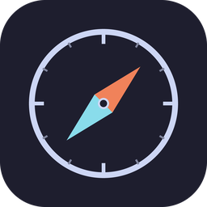
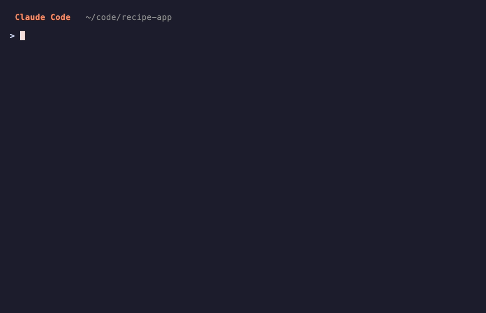

<!-- mph:translation README v0.8.1 -->
<p align="center"></p>

<h1 align="center">multiproject-handoff</h1>

<p align="center"><b>Her projeye kaldığın yerden devam et, hangi AI kodlama aracıyla olursa olsun.</b><br>
Bütün projelerin için tek bir pano. Projeyle birlikte büyüyen notlar. Nasıl çalıştığını öğrenen bir asistan.</p>

<p align="center">
<a href="https://github.com/hegecalapkulu/multiproject-handoff/actions/workflows/check.yml"></a>


</p>

<p align="center"><a href="README.md">English</a> · <a href="README.es.md">Español</a> · <a href="README.zh.md">中文</a> · <a href="README.pt.md">Português</a> · <b>Türkçe</b></p>

> Bu bir çeviridir. Asıl kaynak [İngilizce README](README.md)'dir; bu sayfa ondan geride kalabilir. Ayrıntılı dokümanlar (`docs/`) İngilizcedir. Çeviri düzeltmelerine açığız.

<p align="center"><br>
<sub><code>recipe-app</code>, <a href="examples/workspace/"><code>examples/workspace/</code></a> içindeki uydurma örnek projelerden biri. Aynısını orada kendin dene.</sub></p>

```
> /mph-resume

🧭 3 proje

1. recipe-app      1 gün önce güncellendi
   Arama çalışıyor, 41 test geçiyor; alışveriş listesi yarıda. Şimdi: "öğe sil"i bitir.
2. landing-page    6 gün önce güncellendi
   Müşteriden başlık metni bekleniyor. Şimdi: hero bölümü.
3. cli-tool        23 gün önce güncellendi  ⚠ bayat
   v0.2 çıktı; sırada Windows desteği var. Şimdi: Windows CI runner.

Hangisi? (numara ya da ad)
```

**Kısaca:** AI asistanın sohbeti kapattığında her şeyi unutur. Bu araç her oturumun sonunda ona kısa bir not bırakır ve bir sonraki oturumun başında o notu okutur. Bunu bütün projelerin için yapar, böylece nerede kaldığını bir daha anlatmak zorunda kalmazsın. Üye olmak gerekmez: notlar bilgisayarındaki sıradan metin dosyalarıdır.

Teknik olarak `multiproject-handoff`, düz Markdown ile yazılmış bir [Agent Skills](https://agentskills.io) setidir. Her AI kodlama oturumunu temiz bir devirle (handoff) kapatır ve bir sonrakini sıfırdan değil kısa bir nottan başlatır, **bütün projelerinde**. Sunucu yok, veritabanı yok, hesap yok: sadece kodunun yanında duran Markdown dosyaları.

**En iyi Claude Code ve Codex ile çalışır.** İkisi de baştan sona test edildi; birinde devredip diğerinde devam etmek dahil. Açık Agent Skills formatı üzerine kurulu olduğu için Agent Skills ya da `AGENTS.md` okuyan diğer araçlarla da büyük ölçüde uyumludur (Gemini CLI, Antigravity, Cursor, Copilot, Windsurf…). Bir aracın bir adımı ele alışında ara sıra küçük farklar çıkabilir; bildirimlere açığız.

## Buradan başla: 3 adım

1. **Kur** (bir kez). Claude Code: `/plugin install multiproject-handoff --marketplace hegecalapkulu/multiproject-handoff`. Başka bir araç: [Hızlı başlangıç](#hızlı-başlangıç) bölümündeki metni yapıştır.
2. **Her projeyi ayarla** (bir kez). Projeyi aç ve `/mph-setup-project` çalıştır. Projeyi okur, birkaç soru sorar ve zaten tuttuğun notları korur.
3. **Her oturumda:** başta `/mph-resume`, sonda `/mph-handoff`.

Gereken bu kadar. 3. adımı unuttun mu? Bir oturum devirsiz biterse, bir sonraki `/mph-resume` kaydedilmemiş işi fark eder ve notu git'ten tamamlamayı teklif eder. 2. adımı unuttun mu? Herhangi bir `mph-` komutu bunu fark eder ve önce projeyi ayarlamayı teklif eder. Aşağıdaki her şey devir sırasında ya da sen istediğinde kendiliğinden çalışır; `/mph-menu` hepsini listeler.

## Başka neler yapabilir?

| Şunu istiyorsan… | Kullan | Sonuç |
|---|---|---|
| Var olan projelerini notlarıyla birlikte getirmek | `mph-setup-project` | mevcut dosyaların olduğu yerde sahiplenilir: hiçbir şey taşınmaz, adı değişmez |
| Yeniden anlatmadan kaldığın yerden devam etmek | `mph-resume` · `mph-handoff` | en fazla 8 satırlık durum ve sıradaki adım |
| Birkaç projeyi aynı anda yürütmek | `mph-resume` panosu | bütün projeler tek ekranda, unutulanlar ⚠ ile işaretli |
| Kararları ve araştırmaları sohbette kaybetmemek | `mph-decision-log` · `mph-knowledge` | proje büyüdükçe klasörlere ayrılan notlar ([daha fazla](docs/knowledge.md)) |
| Asistanın her projede senin tarzınla çalışması | `mph-profile` | kısa, kanıta dayalı çalışma tarzı notları, varsayılan olarak yerel ([daha fazla](docs/profile.md)) |
| Sistemin kendini genişletmesi | `mph-suggest-skill` · `mph-suggest-agent` | projeye özel skill'ler ve yardımcı ajanlar; bir kez önerilir, cevabın hatırlanır ([daha fazla](docs/suggestions.md)) |
| Hepsini bir grafik olarak görmek | `mph-obsidian-map` | Obsidian'da bağlantılı notlar, harita notları ve bir Canvas ([daha fazla](docs/obsidian.md)) |

Bir komutu mu unuttun? **`mph-menu`** hepsini gösterir.

## Kod yazmıyor musun?

Tez, araştırma projesi, kitap, müşteri işi ya da bir AI asistanla birçok oturum boyunca yürüttüğün başka herhangi bir iş için de aynı şekilde çalışır. Kararlar, kaynaklar, görüşmeler ve "nerede kalmıştım" tam olarak tuttuğu şeylerdir. Git'e ya da teste ihtiyacın yok: notlar her durumda yazılır. Devir sırasında sürüm geçmişi tek satırla bir kez teklif edilir, istersen kalıcı olarak reddedebilirsin. [`thesis` örneğine](examples/workspace/thesis/) bak.

## Hızlı başlangıç

**Claude Code: tek satır.** Claude Code'un içinde şunu yaz:

```
/plugin install multiproject-handoff --marketplace hegecalapkulu/multiproject-handoff
```

Sonra yeni bir oturum başlat. (Eski Claude Code: önce `/plugin marketplace add hegecalapkulu/multiproject-handoff`, sonra `/plugin install multiproject-handoff@multiproject-handoff`.)

**Herhangi bir AI aracı: kendisi kursun.** Bunu Codex, Cursor, Gemini CLI, Antigravity, Claude Code ya da komut çalıştırabilen herhangi bir ajana yapıştır:

```text
multiproject-handoff'u (https://github.com/hegecalapkulu/multiproject-handoff) şu an çalıştığın AI aracı için kur: repoyu klonla, `./install.sh --dry-run` çalıştırıp neyi değiştireceğini bana göster, ben evet deyince bu araç için kur. Sonunda nasıl başlayacağımı söyle.
```

**Ya da elle (Codex, Gemini CLI, Antigravity, Cursor… ya da eklentisiz Claude Code):**

```bash
git clone https://github.com/hegecalapkulu/multiproject-handoff.git
cd multiproject-handoff
./install.sh        # bu bilgisayardaki AI araçlarını bulur ve her biri için kurar
```

**Bir dakikada dene:** AI aracını [`examples/workspace/`](examples/workspace/) içinde aç (biri tez olmak üzere, içi dolu dört proje) ve `/mph-resume` çalıştır.

**Kendi projende kullan:** projeyi (ya da projelerle dolu bir klasörü veya Obsidian kasasını) aç ve `/mph-setup-project` çalıştır. Önce etrafa bakar: zaten tuttuğun notlar (`TODO.md`, `docs/adr/`, bir durum notu, araştırma klasörleri…) **olduğu yerde sahiplenilir** ve sadece kendi çıkaramadığını tek ekranda sorar. Bundan sonra: oturumu başlatmak için `/mph-resume`, bitirmek için `/mph-handoff`. Slash komutu olmayan araçlarda "resume" ya da "handoff" demen yeterli.

## Nasıl çalışır

Asistanını açar ve `mph-resume` yazarsın. Projeleri arar, her projenin devam notunun sadece ilk satırlarını okur ve panoyu gösterir. Birini seçersin. Şimdi o projenin kısa devam notunu, backlog'unun en üstünü ve çalışma tarzı notlarını okur, işlerin nerede olduğunu ve sırada ne olduğunu birkaç satırla söyler. O proje bütün oturum boyunca aktif kalır; hiçbir skill tekrar sormaz.

**Birden fazla AI aracı mı kullanıyorsun?** Notlar düz dosyalar olduğu için Claude Code, Codex, Cursor ve diğerleri aynı notları okur: birinde devret, diğerinde devam et. Bir projede araçları **teker teker** kullan; birbirlerinden haberleri yok, aynı anda aynı notu yazan iki ajan birbirinin yazdığını ezebilir.

Çalışırsın. Bir şey seçtiğinde ("arama servisi değil SQLite kullanalım"), `mph-decision-log` onu nedeniyle birlikte yazar. Rakipleri araştırdığında ya da bir müşteriyle konuştuğunda, `mph-knowledge` onu bir konu başlığı altına dosyalar. Başka bir projeye ait bir düzeltmeden bahset, *o* projenin backlog'una gider.

Bitirdiğinde `mph-handoff` yazarsın. Gerçekte ne olduğunu hafızadan değil git'ten ve testlerden kontrol eder ve tek bir satır gösterir: *yapılacak: log · karar · bilgi · devam notu · commit; atlanacak: profil (yeni bir şey yok)*. Enter'a basarsın. Sadece bu oturumun ürettiğini yazar, devam notunu kısa tutarak yeniden yazar ve commit eder. Acelen mi var? `mph-handoff quick` sadece devam notunu kaydeder. Klasörde henüz git yok mu? Devir, nedenini tek satırla açıklayarak git'i başlatmayı bir kez teklif eder: o andan itibaren her devir geri dönebileceğin bir sürüm olur. "Şimdi değil" dersen bir dahaki sefere tekrar sorar; "asla" dersen sormayı bırakır.

Haftalar içinde notlar büyür: bir rakipler dosyası klasöre dönüşür, kararlar alanlara göre ayrılır. Aynı angarya işi elle yapmaya devam edersen, devir bunun için bir skill isteyip istemediğini bir kez sorar ve cevabını hatırlar. [Ayrıntılı anlatım →](docs/how-it-works.md)

## Bir projede neler var

```
recipe-app/notes/
├── PROJECT.md          ayarların: kontroller, modüller, haritalar, yapı kuralları
├── RESUME.md           en fazla 60 satır: neredeyiz · denendi, olmadı · açık sorular · sıradaki
├── BACKLOG.md          sadece açık işler
├── decisions/          her karar + tarih + neden
├── knowledge/          araştırma, rakipler, görüşmeler… klasörlere ayrılarak büyür
├── daily/              sadece sona ekleme yapılan günlük
└── working-style.md    burada nasıl çalışmayı sevdiğin (varsayılan olarak git'e girmez)
```

**Repon public mi, ya da notlarını gizli tutmayı mı tercih ediyorsun?** Notların kodun yanında durması gerekmez: onları gizli bir klasörde ya da bir Obsidian kasasında tut ve `PROJECT.md` içinden koda işaret et ([nasıl](docs/how-it-works.md#where-the-files-live)). Takım halinde mi çalışıyorsun? [Takımda kullanım](docs/team.md) sayfasına bak.

**Projeler dosya adlarıyla değil, bir işaretle tanınır.** `PROJECT.md`'nin ilk satırı (`<!-- mph:project recipe-app -->`) not klasörünü işaretler; böylece aslında CV'n olan bir `RESUME.md` ya da toplantı notlarıyla dolu bir `notes/` klasörü asla bizimki sanılmaz. Not klasörünün adı herhangi bir şey olabilir (`notes/`, `.mph/`, `00 Notlar/`). [`examples/workspace/landing-page/`](examples/workspace/landing-page/) örneğine bak: kendi `notes/` klasörüne dokunulmayan, sahiplenilmiş bir proje.

**Senin yapın, senin kuralların.** Notların nasıl düzenlendiğiyle ilgili her şey `PROJECT.md`'de durur: klasör adları, dil, numaralandırma, neyin nereye gittiği, hangi modüllerin açık olduğu. Her skill buna uyar; böylece bir müşteri projesi, bir tez ve bir yan uygulama aynı skill'lerle her biri istediğin gibi görünebilir. [Daha fazla →](docs/knowledge.md#your-structure-your-rules)

## Skill'ler

**Çekirdek** (her zaman açık)

| Skill | Ne yapar |
|---|---|
| `mph-resume [proje]` | Bütün projelerin panosu ya da doğrudan birine giriş. Sadece okur. |
| `mph-handoff [quick]` | Git ve testlerden gerçekler → tek satırlık plan → sadece oturumun ürettiğini yazar → commit. |
| `mph-setup-project` | Bir projeyi ayarlar ya da projenin (veya bütün bir kasanın) zaten sahip olduğu notları sahiplenir. Asla taşımaz, adını değiştirmez, üzerine yazmaz. |
| `mph-decision-log` | Nedeniyle birlikte bir karar; karar değişince eskisinin yerine geçer. |
| `mph-daily-log` | Tam bir devir yapmadan bugünün günlüğü. |
| `mph-menu` | Bütün komutlar tek ekranda, artı aktif proje. |

**Modüller** (her proje için `PROJECT.md`'den açılır ya da kapatılır)

| Skill | Modül | Varsayılan | Ne yapar |
|---|---|---|---|
| `mph-knowledge` | knowledge | açık | Araştırmayı konulara dosyalar; yeni konular ve bölmeler önerir; "notları düzenle". |
| `mph-profile` | profile | açık | Proje başına çalışma tarzı; iki projede görülünce genel profile taşınır. |
| `mph-suggest-skill` | suggestions | açık | Tekrarlanan elle yapılan işi fark eder, projeye özel bir skill önerir, cevabı hatırlar. |
| `mph-suggest-agent` | suggestions | açık | Ağır ve gürültülü işler için yardımcı bir ajan önerir. |
| `mph-obsidian-map` | obsidian | kapalı | Notları bağlar, etiket ekler, harita notlarını ve bir Canvas'ı güncel tutar. |

**İsteğe bağlı güvenlik kalkanı:** `mph-guard`, dosya silmeyi, git geçmişini yeniden yazmayı ve `.env` sırlarını okumayı *gerçekten* engelleyen, adını verdiğin komutlardan (deploy, publish) önce soran bir Claude Code hook'u kurar. Neyi engelleyeceğini sen seçersin; ayarlarını sadece evet dedikten sonra değiştirir. [Daha fazla →](docs/install.md#safety-guard)

Bütün skill'ler önce ortak bir [`RULES.md`](shared/RULES.md) okur: projelerin nasıl bulunduğu, aktif proje, modüller ve güvenlik kuralları.

## Aracına göre kurulum

`./install.sh`; Claude Code, Codex, Gemini CLI ve Antigravity'yi kendisi bulur. Seçmek için:

<details>
<summary>Seçenekler</summary>

| Kullandığın | Komut |
|---|---|
| Claude Code | `./install.sh --tool claude` → `~/.claude/skills/` |
| Codex | `./install.sh --tool codex` → `~/.codex/skills/` |
| `~/.agents/skills` okuyan araçlar | `./install.sh --tool agents` |
| Gemini CLI | `./install.sh --tool gemini` → `~/.gemini/skills/` |
| Antigravity | `./install.sh --tool antigravity` → `~/.gemini/antigravity/skills/` |
| Herhangi bir skill klasörü | `./install.sh --dir YOL` |
| Sadece tek bir proje | `./install.sh --project ~/code/app [--tool claude]` |
| Skill desteği olmayan araçlar (Cursor, Copilot, Windsurf…) | `./install.sh --agents-md ~/code`, `AGENTS.md`'ye kısa bir blok ekler |

Windows'ta Git Bash (Git for Windows ile gelir) ya da WSL içinden çalıştır; bkz. [Windows](docs/install.md#windows). Ne olacağını görmek için `--dry-run`, güncellemek için `--update` ekle. Skill klasörleri araçtan araca ve sürümden sürüme değişir; aracın skill'leri görmüyorsa dokümanlarına bak ve `--dir` kullan. [Ayrıntılar →](docs/install.md)

</details>

Kurucu hiçbir şey silmez, bize ait olmayan aynı adlı skill'leri atlar ve `AGENTS.md`'ye sadece bir kez ekleme yapar.

## Kaldırma

Hiçbir şey silinmez: kurulan her şey `~/.handoff-removed/<tarih-saat>/` klasörüne **taşınır** ve **proje notların** düz Markdown olarak **kalır**.

1. **Claude Code eklentisi:** `/plugin uninstall multiproject-handoff` yaz (ve `/plugin marketplace remove multiproject-handoff`).
2. **`install.sh` ile kurduysan ya da güvenlik kalkanını ayarladıysan:** repo klasöründen önce bak, sonra kaldır:
   ```bash
   ./install.sh --uninstall --dry-run
   ./install.sh --uninstall
   ```
   Sadece kurucumuzun işaretlediği skill'leri, `~/.handoff/` içindeki dosyalarımızı, `~/.claude/settings.json` içindeki kalkan kayıtlarını (bir kopyası saklanır) ve `--agents-md DIR` ile `DIR/AGENTS.md` içindeki bloğu taşır. Kendi skill'lerin, hook'ların ve çalışma tarzı notların kalır.
3. **Ya da AI aracın yapsın.** Şunu yapıştır:
   ```text
   multiproject-handoff'u (https://github.com/hegecalapkulu/multiproject-handoff) bu bilgisayardan kaldır: repoyu al, `./install.sh --uninstall --dry-run` çalıştırıp neyi değiştireceğini bana göster, ben evet deyince `./install.sh --uninstall --yes` çalıştır. Proje notlarımı koru.
   ```

Sonra araçlarını yeniden başlat. Emin olduğunda `~/.handoff-removed/` klasörünü kendin sil. [Ayrıntılar →](docs/install.md#uninstall)

## Güvenlik

- **Asla dosya silmez.** Notlar düzenlenir, sonlarına eklenir ya da `git mv` ile taşınır.
- **Asla git geçmişini yeniden yazmaz.** Başarısız bir push raporlanır, zorlanmaz.
- **Asla olmayan bir işi olmuş gibi göstermez.** "Testler geçiyor" sadece devir sırasında gerçekten geçtiyse yazılır.
- **Kararı sen verirsin.** Yeni konular, bölmeler, skill'ler ve ajanlar sen evet diyene kadar sadece öneridir.
- **Notlarda sır yok** ve çalışma tarzı profilin, sen aksini seçmedikçe bilgisayarında kalır.
- **Söz yerine zorunluluk mu istiyorsun?** `mph-guard` bu kuralları, eylem çalışmadan önce onu engelleyen bir hook'a çevirir.
- **Ağ yok, hesap yok, telemetri yok.** Bilgisayarında tam olarak neyi okuduğu, yazdığı ve değiştirdiği: [Güvenlik özeti](docs/security.md).

## Sana göre mi?

**Evet**, eğer AI ajanlarıyla birkaç projede çalışıyorsan, araçlar arasında geçiş yapıyorsan ya da oturumlar arasında kararları ve araştırmaları kaybedip duruyorsan. Buna kod dışı işler de dahil: tez, araştırma, yazı, müşteri projeleri.

**Muhtemelen hayır**, eğer tek bir küçük projen ve kısa oturumların varsa (aracının yerleşik hafızası yeter), tamamen otomatik ve görünmez bir hafıza istiyorsan (bu sana her şeyi gösterir ve yapıyı değiştirmeden önce sorar) ya da takımının memnun olduğu bir dokümantasyon sistemi zaten varsa.

## Farkı ne

Bu alandaki çoğu araç **tek bir proje için tek bir devir dosyası** ya da tek bir araca bağlı bir hafıza bankası tutar. Bu araç ise **aynı anda birçok proje** için yapıldı. Her bilgi türüne kendi yaşam döngüsünü verir (durum yeniden yazılır, kararlar değiştirilir, günlüklere sadece ekleme yapılır, bilgi klasörlere ayrılarak büyür) ve Markdown okuyan her ajanda aynı şekilde çalışır. [Karşılaştırma ve SSS →](docs/comparison.md)

## Dokümantasyon (İngilizce)

[Nasıl çalışır](docs/how-it-works.md) · [Güvenlik](docs/security.md) · [Takımlar](docs/team.md) · [Büyüyen notlar](docs/knowledge.md) · [Çalışma tarzı profili](docs/profile.md) · [Öneriler](docs/suggestions.md) · [Obsidian](docs/obsidian.md) · [Kurulum](docs/install.md) · [Karşılaştırma ve SSS](docs/comparison.md) · [Değişiklik günlüğü](CHANGELOG.md)

## Katkı

Issue ve PR'lara açığız; özellikle başka araçlar için doğrulanmış skill klasörü yolları, farklı teknolojiler için `PROJECT.md` örnekleri ve `mph-resume`'un *daha az* okumasını sağlayan değişiklikler. Çeviri düzeltmeleri de çok makbule geçer. `shared/` klasörünü düzenledikten sonra `scripts/sync.sh`, PR göndermeden önce `scripts/check.sh` çalıştır.

## Lisans

MIT
