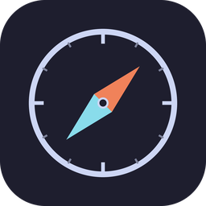
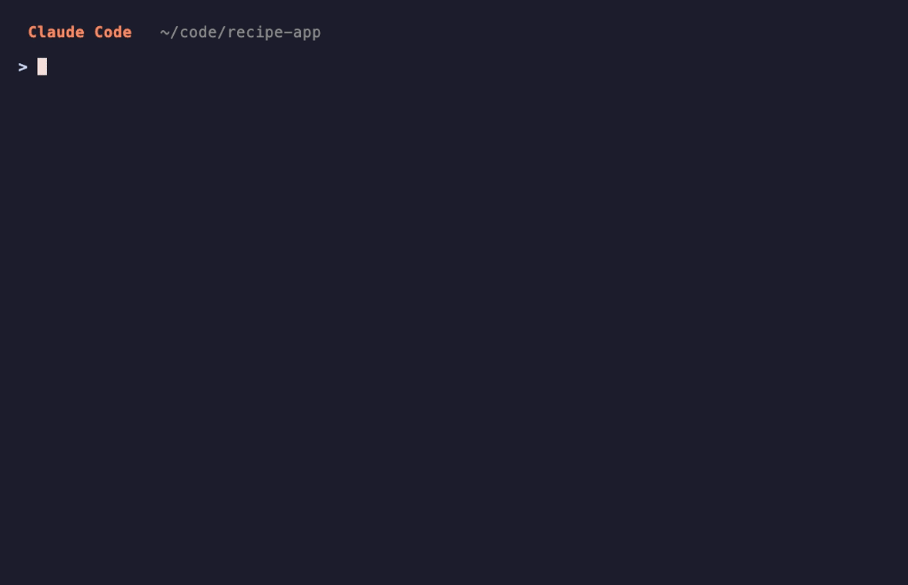

<!-- mph:translation README v0.8.1 -->
<p align="center"></p>

<h1 align="center">multiproject-handoff</h1>

<p align="center"><b>无论使用哪种 AI 编程助手，都能从上次停下的地方继续任何项目。</b><br>
一个面板管理所有项目。笔记随项目一起成长。助手会学习你的工作方式。</p>

<p align="center">
<a href="https://github.com/hegecalapkulu/multiproject-handoff/actions/workflows/check.yml"></a>


</p>

<p align="center"><a href="README.md">English</a> · <a href="README.es.md">Español</a> · <b>中文</b> · <a href="README.pt.md">Português</a> · <a href="README.tr.md">Türkçe</a></p>

> 这是一份翻译。以[英文 README](README.md) 为准，本页可能会滞后。详细文档（`docs/`）为英文。欢迎改进翻译。

<p align="center"><br>
<sub><code>recipe-app</code> 是 <a href="examples/workspace/"><code>examples/workspace/</code></a> 中虚构的示例项目之一。你可以在那里亲自试试。</sub></p>

```
> /mph-resume

🧭 3 个项目

1. recipe-app      1 天前更新
   搜索可用，41 个测试通过；购物清单完成一半。现在：完成"删除条目"。
2. landing-page    6 天前更新
   等待客户提供标题文案。现在：首屏区域。
3. cli-tool        23 天前更新  ⚠ 已过期
   v0.2 已发布；下一步是 Windows 支持。现在：Windows CI runner。

选哪个？（编号或名称）
```

**简单来说：** 关闭对话后，你的 AI 助手会忘掉一切。这个工具会在每次会话结束时给它留下一份简短笔记，并在下次会话开始时让它读回来。所有项目都是如此，你再也不用重新解释上次做到哪里。无需注册：笔记就是你电脑上的普通文本文件。

从技术上讲，`multiproject-handoff` 是一组用纯 Markdown 写成的 [Agent Skills](https://agentskills.io)。它让每次 AI 编程会话以一次干净的交接（handoff）结束，下一次会话从一份简短笔记而不是从零开始，**覆盖你所有的项目**。没有服务器，没有数据库，没有账号：只有放在代码旁边的 Markdown 文件。

**与 Claude Code 和 Codex 配合最好。** 两者都经过端到端测试，包括在一个工具中交接、在另一个中继续。它基于开放的 Agent Skills 格式，因此与其他读取 Agent Skills 或 `AGENTS.md` 的工具高度兼容（Gemini CLI、Antigravity、Cursor、Copilot、Windsurf……）。个别工具处理某个步骤的方式偶尔会有细微差别，欢迎反馈。

## 从这里开始：3 步

1. **安装**（一次）。Claude Code：`/plugin install multiproject-handoff --marketplace hegecalapkulu/multiproject-handoff`。其他工具：粘贴[快速开始](#快速开始)中的提示词。
2. **设置每个项目**（一次）。打开项目并运行 `/mph-setup-project`。它会读取项目，问几个问题，并保留你已有的笔记。
3. **每次会话：** 开始时 `/mph-resume`，结束时 `/mph-handoff`。

就这么多。忘了第 3 步？如果某次会话没有交接就结束了，下一次 `/mph-resume` 会发现未保存的工作，并提议根据 git 补上笔记。忘了第 2 步？任何 `mph-` 命令都会发现，并提议先设置项目。下面的一切都会在交接时或你需要时自动运行；`/mph-menu` 会列出全部功能。

## 还能做什么？

| 你想要…… | 使用 | 你会得到 |
|---|---|---|
| 把已有项目连同笔记一起接入 | `mph-setup-project` | 现有文件原地接管：不移动，不改名 |
| 不用重新解释就从上次停下的地方继续 | `mph-resume` · `mph-handoff` | 不超过 8 行的状态和下一步 |
| 同时推进多个项目 | `mph-resume` 面板 | 所有项目一屏可见，被遗忘的项目标记为 ⚠ |
| 保存决策和调研，而不是让它们淹没在对话里 | `mph-decision-log` · `mph-knowledge` | 随项目成长而拆分成文件夹的笔记（[详情](docs/knowledge.md)） |
| 让助手在每个项目里按你的方式工作 | `mph-profile` | 简短、基于事实的工作风格笔记，默认仅保存在本地（[详情](docs/profile.md)） |
| 让系统自我扩展 | `mph-suggest-skill` · `mph-suggest-agent` | 项目专属 skill 和辅助代理，只建议一次，并记住你的回答（[详情](docs/suggestions.md)） |
| 以图谱形式查看一切 | `mph-obsidian-map` | Obsidian 中的互链笔记、地图笔记和 Canvas（[详情](docs/obsidian.md)） |

忘了某个命令？**`mph-menu`** 会全部列出。

## 不写代码？

论文、研究项目、写书、客户工作，或任何你与 AI 助手跨多次会话完成的事情，都同样适用。决策、资料来源、访谈和"我做到哪了"，正是它所记录的内容。你不需要 git 或测试：笔记照样会写入；交接时只会用一行提议一次启用版本历史，你可以永久拒绝。参见 [`thesis` 示例](examples/workspace/thesis/)。

## 快速开始

**Claude Code：一行命令。** 在 Claude Code 中输入：

```
/plugin install multiproject-handoff --marketplace hegecalapkulu/multiproject-handoff
```

然后开启新会话。（旧版 Claude Code：先 `/plugin marketplace add hegecalapkulu/multiproject-handoff`，再 `/plugin install multiproject-handoff@multiproject-handoff`。）

**任何 AI 工具：让它自己安装。** 把下面这段粘贴到 Codex、Cursor、Gemini CLI、Antigravity、Claude Code 或任何能运行命令的代理中：

```text
为你当前所在的 AI 工具安装 multiproject-handoff（https://github.com/hegecalapkulu/multiproject-handoff）：克隆仓库，运行 `./install.sh --dry-run` 并告诉我会改动什么，在我同意后为这个工具安装。最后告诉我如何开始。
```

**或者手动安装（Codex、Gemini CLI、Antigravity、Cursor……或不使用插件的 Claude Code）：**

```bash
git clone https://github.com/hegecalapkulu/multiproject-handoff.git
cd multiproject-handoff
./install.sh        # 查找本机上的 AI 工具并逐一安装
```

**一分钟试用：** 在 [`examples/workspace/`](examples/workspace/) 中打开你的 AI 工具（四个已填好内容的项目，其中一个是论文），然后运行 `/mph-resume`。

**用在你的项目上：** 打开项目（或包含多个项目的文件夹、Obsidian 仓库），运行 `/mph-setup-project`。它会先看看周围：你已有的笔记（`TODO.md`、`docs/adr/`、状态笔记、调研文件夹……）会被**原地接管**，它只在一个屏幕上询问它推断不出的内容。之后：用 `/mph-resume` 开始会话，用 `/mph-handoff` 结束会话。在没有斜杠命令的工具中，只需说 "resume" 或 "handoff"。

## 工作原理

你打开助手，输入 `mph-resume`。它查找项目，只读取每个项目续接笔记的前几行，然后显示面板。你选一个。接着它读取该项目简短的续接笔记、backlog 的顶部和你的工作风格笔记，用几行告诉你目前的进展和下一步。该项目在整个会话中保持激活，任何 skill 都不会再问。

**同时使用多个 AI 工具？** 笔记是普通文件，所以 Claude Code、Codex、Cursor 等都读同一份：在一个工具中交接，在另一个中继续。同一个项目请**一次只用一个**工具；它们互不知情，两个代理同时写同一份笔记可能会互相覆盖。

你开始工作。当你做出选择时（"用 SQLite，不用搜索服务"），`mph-decision-log` 会连同理由一起记下。当你调研竞品或与客户交谈时，`mph-knowledge` 会把内容归档到某个主题下。提到一个属于其他项目的修复，它就会进入*那个*项目的 backlog。

停下时，你输入 `mph-handoff`。它根据 git 和测试而不是记忆来核实实际发生了什么，并显示一行：*将执行：日志 · 决策 · 知识 · 续接笔记 · 提交；跳过：个人档案（没有新内容）*。你按下回车。它只写入本次会话产生的内容，把续接笔记重写得简短，然后提交。赶时间？`mph-handoff quick` 只保存续接笔记。文件夹里还没有 git？交接会用一行说明理由，提议启用一次：此后每次交接都会成为一个可以回退的版本。说"以后再说"，它下次还会问；说"永不"，它就不再问。

几周下来，笔记不断成长：竞品文件变成文件夹，决策按领域拆分；如果你一直手动做同一件杂事，交接时会问你一次是否需要为它建一个 skill，并记住你的回答。[完整演示 →](docs/how-it-works.md)

## 项目里有什么

```
recipe-app/notes/
├── PROJECT.md          你的设置：检查、模块、地图、结构规则
├── RESUME.md           ≤60 行：当前进展 · 试过但不行 · 待解决问题 · 下一步
├── BACKLOG.md          只放未完成的工作
├── decisions/          每个决策 + 日期 + 原因
├── knowledge/          调研、竞品、访谈……逐步拆分成文件夹
├── daily/              只追加的日志
└── working-style.md    你在这里喜欢的工作方式（默认被 git 忽略）
```

**公开仓库，或者想把笔记保密？** 笔记不必和代码放在一起：把它们放在私密文件夹或 Obsidian 仓库中，再在 `PROJECT.md` 里指向代码位置（[方法](docs/how-it-works.md#where-the-files-live)）。团队协作？参见[在团队中使用](docs/team.md)。

**项目通过标记识别，而不是文件名。** `PROJECT.md` 的第一行（`<!-- mph:project recipe-app -->`）标记了笔记文件夹，因此一个其实是你简历的 `RESUME.md`，或一个装满会议记录的 `notes/` 文件夹，永远不会被误认为是我们的。笔记文件夹可以取任何名字（`notes/`、`.mph/`、`00 笔记/`）。参见 [`examples/workspace/landing-page/`](examples/workspace/landing-page/)：一个被接管的项目，它自己的 `notes/` 文件夹保持原样。

**你的结构，你的规则。** 关于笔记如何组织的一切都写在 `PROJECT.md` 中：文件夹名称、语言、编号、内容放在哪里、开启哪些模块。所有 skill 都遵循它，所以客户项目、论文和个人应用可以用同一套 skill，各自呈现你想要的样子。[详情 →](docs/knowledge.md#your-structure-your-rules)

## Skills

**核心**（始终开启）

| Skill | 作用 |
|---|---|
| `mph-resume [项目]` | 所有项目的面板，或直接进入某个项目。只读。 |
| `mph-handoff [quick]` | 来自 git 和测试的事实 → 一行计划 → 只写入本次会话产生的内容 → 提交。 |
| `mph-setup-project` | 设置一个项目，或接管它（或整个仓库）已有的笔记。从不移动、改名或覆盖。 |
| `mph-decision-log` | 记录决策及其理由；决策变化时替换旧的。 |
| `mph-daily-log` | 不做完整交接，只写今天的日志。 |
| `mph-menu` | 所有命令一屏显示，外加当前激活的项目。 |

**模块**（在每个项目的 `PROJECT.md` 中开关）

| Skill | 模块 | 默认 | 作用 |
|---|---|---|---|
| `mph-knowledge` | knowledge | 开 | 按主题归档调研；建议新主题和拆分；"整理笔记"。 |
| `mph-profile` | profile | 开 | 按项目记录工作风格；在两个项目中出现后提升为通用档案。 |
| `mph-suggest-skill` | suggestions | 开 | 发现重复的手动工作，建议一个项目 skill，并记住回答。 |
| `mph-suggest-agent` | suggestions | 开 | 为繁重、嘈杂的工作建议一个辅助代理。 |
| `mph-obsidian-map` | obsidian | 关 | 链接笔记、添加标签，维护地图笔记和 Canvas。 |

**可选的安全防护：** `mph-guard` 会设置一个 Claude Code hook，*真正*阻止删除文件、改写 git 历史和读取 `.env` 机密，并在你指定的命令（deploy、publish）执行前询问。阻止什么由你选择；只有在你同意后它才会修改设置。[详情 →](docs/install.md#safety-guard)

所有 skill 都会先读取共享的 [`RULES.md`](shared/RULES.md)：如何查找项目、激活的项目、模块以及安全规则。

## 按工具安装

`./install.sh` 会自动检测 Claude Code、Codex、Gemini CLI 和 Antigravity。手动选择：

<details>
<summary>选项</summary>

| 你使用 | 命令 |
|---|---|
| Claude Code | `./install.sh --tool claude` → `~/.claude/skills/` |
| Codex | `./install.sh --tool codex` → `~/.codex/skills/` |
| 读取 `~/.agents/skills` 的工具 | `./install.sh --tool agents` |
| Gemini CLI | `./install.sh --tool gemini` → `~/.gemini/skills/` |
| Antigravity | `./install.sh --tool antigravity` → `~/.gemini/antigravity/skills/` |
| 任意 skills 文件夹 | `./install.sh --dir 路径` |
| 仅一个项目 | `./install.sh --project ~/code/app [--tool claude]` |
| 不支持 skill 的工具（Cursor、Copilot、Windsurf……） | `./install.sh --agents-md ~/code` 会在 `AGENTS.md` 中添加一小段说明 |

在 Windows 上，请在 Git Bash（随 Git for Windows 一起安装）或 WSL 中运行；参见 [Windows](docs/install.md#windows)。加 `--dry-run` 查看将会发生什么，加 `--update` 进行更新。skill 文件夹因工具和版本而异；如果你的工具看不到这些 skill，请查阅其文档并使用 `--dir`。[详情 →](docs/install.md)

</details>

安装程序从不删除任何东西，会跳过同名但不属于我们的 skill，并且只向 `AGENTS.md` 追加一次。

## 卸载

不会删除任何东西：安装的内容会被**移动**到 `~/.handoff-removed/<日期-时间>/`，**你的项目笔记保持不变**，仍是普通 Markdown。

1. **Claude Code 插件：** 输入 `/plugin uninstall multiproject-handoff`（以及 `/plugin marketplace remove multiproject-handoff`）。
2. **用 `install.sh` 安装的，或设置过安全防护：** 在仓库文件夹中先查看，再移除：
   ```bash
   ./install.sh --uninstall --dry-run
   ./install.sh --uninstall
   ```
   它只移动我们安装程序标记过的 skill、`~/.handoff/` 中我们的文件、`~/.claude/settings.json` 中防护的条目（会保留一份副本），以及使用 `--agents-md DIR` 时 `DIR/AGENTS.md` 中的那一段。你自己的 skill、hook 和工作风格笔记都会保留。
3. **或者让你的 AI 工具来做。** 粘贴：
   ```text
   从这台机器上卸载 multiproject-handoff（https://github.com/hegecalapkulu/multiproject-handoff）：获取仓库，运行 `./install.sh --uninstall --dry-run` 并告诉我会改动什么，在我同意后运行 `./install.sh --uninstall --yes`。保留我的项目笔记。
   ```

之后重启你的工具。确认无误后，自行删除 `~/.handoff-removed/`。[详情 →](docs/install.md#uninstall)

## 安全

- **从不删除文件。** 笔记只会被编辑、追加或用 `git mv` 移动。
- **从不改写 git 历史。** push 失败会被报告，而不是强制推送。
- **从不声称没发生的工作。** 只有在交接时测试确实通过，才会写"测试通过"。
- **由你决定。** 新主题、拆分、skill 和代理在你同意之前都只是建议。
- **笔记中没有机密**，你的工作风格档案默认只留在你的电脑上。
- **想要强制执行，而不只是承诺？** `mph-guard` 会把这些规则变成一个 hook，在操作执行前就将其阻止。
- **无网络、无账号、无遥测。** 它在你电脑上究竟读取、写入和修改什么：[安全概览](docs/security.md)。

## 适合你吗？

**适合**，如果你用 AI 代理同时做多个项目、在不同工具之间切换，或者总是在会话之间丢失决策和调研。这也包括非代码工作：论文、研究、写作、客户项目。

**可能不适合**，如果你只有一个小项目且会话很短（工具自带的记忆就够了），如果你想要完全自动、不可见的记忆（这个工具会把一切都展示给你，并在改变结构前询问），或者你的团队已经有一套满意的文档系统。

## 有何不同

这个领域的大多数工具为**一个项目保留一个交接文件**，或者是绑定在某个工具上的记忆库。本工具为**同时管理多个项目**而设计，给每类信息各自的生命周期（状态会被重写，决策会被替换，日志只追加，知识逐步拆分成文件夹），并且在任何能读 Markdown 的代理中表现一致。[比较与常见问题 →](docs/comparison.md)

## 文档（英文）

[工作原理](docs/how-it-works.md) · [安全](docs/security.md) · [团队](docs/team.md) · [不断成长的笔记](docs/knowledge.md) · [工作风格档案](docs/profile.md) · [建议](docs/suggestions.md) · [Obsidian](docs/obsidian.md) · [安装](docs/install.md) · [比较与常见问题](docs/comparison.md) · [更新日志](CHANGELOG.md)

## 参与贡献

欢迎提交 issue 和 PR，尤其是：更多工具的已验证 skill 文件夹路径、不同技术栈的 `PROJECT.md` 示例，以及让 `mph-resume` 读得*更少*的改动。也非常欢迎改进翻译。编辑 `shared/` 后请运行 `scripts/sync.sh`；提交 PR 前请运行 `scripts/check.sh`。

## 许可证

MIT
